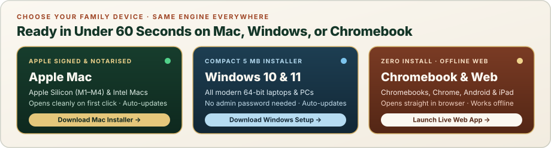

  

&nbsp;&nbsp;&nbsp;&nbsp;

  <strong>Calm, intelligent entrance-exam preparation for Years 4 to 9 — built for real families, not noisy quiz streaks.</strong> 
  No account required · Zero ads or child tracking · Works completely offline on Mac, Windows, and Chromebooks

  <strong><a href="https://gitdakky.github.io/pretest-studio-releases/">Parent Download Page</a></strong>
  &nbsp;·&nbsp;
  <strong><a href="https://github.com/GitDakky/pretest-studio-releases/releases/latest/download/PreTest-Studio-macOS-Universal.dmg">Download for Mac</a></strong>
  &nbsp;·&nbsp;
  <strong><a href="https://github.com/GitDakky/pretest-studio-releases/releases/latest/download/PreTest-Studio-Windows-Setup.exe">Download for Windows</a></strong>
  &nbsp;·&nbsp;
  <strong><a href="https://gitdakky.github.io/pretest-studio-releases/app/">Open Chromebook Web App</a></strong>

---

## Choose Your Device (Ready in Under 60 Seconds)

You do **not** need to be technical, create an account, or install any extra software. Simply pick your family's device below:

  

| Your Device | One-Click Download / Launch | What to Expect |
| :--- | :--- | :--- |
| **Apple Mac** *(MacBook, iMac, Mac mini)* | **[Download `PreTest-Studio-macOS-Universal.dmg`](https://github.com/GitDakky/pretest-studio-releases/releases/latest/download/PreTest-Studio-macOS-Universal.dmg)** *(16 MB)* | **Apple Signed & Notarised.** Works on all modern Macs (M1/M2/M3/M4 & Intel). Opens cleanly on first click. |
| **Windows 10 or 11 PC** *(Laptop or Desktop)* | **[Download `PreTest-Studio-Windows-Setup.exe`](https://github.com/GitDakky/pretest-studio-releases/releases/latest/download/PreTest-Studio-Windows-Setup.exe)** *(5.2 MB)* | Compact, fast installer. No administrator password required. Updates automatically in-app. |
| **Chromebook, Chrome, Android or iPad** | **[Open PreTest Studio Web App](https://gitdakky.github.io/pretest-studio-releases/app/)** *(Zero install)* | Opens straight inside Google Chrome or Safari. Runs the full adaptive engine offline after first load. |

---

## Step-by-Step Installation Guide (Plain English)

### 1. Apple Mac (macOS)

1. Click **[Download for Mac](https://github.com/GitDakky/pretest-studio-releases/releases/latest/download/PreTest-Studio-macOS-Universal.dmg)** above.
2. Open your **Downloads** folder and double-click **`PreTest-Studio-macOS-Universal.dmg`**.
3. A window will open showing **PreTest Studio** next to your **Applications** folder. **Drag PreTest Studio onto Applications** *(important: please copy it into Applications rather than running it from inside the download window so automatic updates work properly)*.
4. Open your **Applications** folder (or Launchpad) and double-click **PreTest Studio**.
5. Because every Mac release is **digitally signed and notarised by Apple**, macOS verifies the app automatically and opens it cleanly — no security workarounds required.

---

### 2. Windows 10 & Windows 11 PC

1. Click **[Download for Windows](https://github.com/GitDakky/pretest-studio-releases/releases/latest/download/PreTest-Studio-Windows-Setup.exe)** above (only 5.2 MB — downloads in a couple of seconds).
2. Open your **Downloads** folder and double-click **`PreTest-Studio-Windows-Setup.exe`**.
3. **If Windows shows a blue "Windows protected your PC" screen (normal during Beta):**
   * Because Windows builds are currently in Beta prior to Microsoft EV certificate issuance, Windows SmartScreen asks you to confirm new apps it hasn't seen widely yet.
   * Simply click **`More info`** (underlined text on the left), then click **`Run anyway`**.
4. Click **Next** through the short 15-second setup wizard (no Windows administrator password needed).
5. Open **PreTest Studio** from your Start Menu or Desktop shortcut.

---

### 3. Chromebook, Google Chrome, Android & iPad

Many schools issue pupils a **Chromebook** where installing `.exe` or `.dmg` files is locked down by the school. PreTest Studio runs the exact same adaptive Rust engine directly inside Chrome with **zero installation blocked by school IT**:

1. Open Google Chrome (or Edge / Safari on iPad) and visit:
   **[https://gitdakky.github.io/pretest-studio-releases/app/](https://gitdakky.github.io/pretest-studio-releases/app/)**
2. **Make it behave like a real offline app (optional, takes 5 seconds):**
   * **On a Chromebook or Chrome laptop:** Look at the right-hand side of the address bar and click the small **Install PreTest Studio** icon (computer screen with a downward arrow), then click **Install**. It now sits on the Chromebook shelf and opens full-screen even on aeroplanes or without Wi-Fi.
   * **On an iPad or iPhone:** Tap the **Share** button (square with upward arrow) and choose **Add to Home Screen**.
   * **On an Android tablet:** Tap the three-dot menu in Chrome and select **Add to Home screen / Install app**.

---

## Why Parents Trust PreTest Studio

We designed PreTest Studio for our own families first, with strict privacy and academic integrity built into the foundation:

* **Verified & Signed Releases:** Every Mac release is **Apple Developer ID Signed & Notarised** (Team ID `LFDZF22ZJ6`, verified by Apple's notary service before publication). Every automatic desktop update is cryptographically verified using an **Ed25519 signature** before it installs, and public **[`SHA256SUMS.txt`](https://github.com/GitDakky/pretest-studio-releases/releases/latest/download/SHA256SUMS.txt)** checksums are published with every release.
* **100% Private & On-Device:** There are **no cloud accounts, no pupil logins, no adverts, and zero analytics tracking your child**. All scores, profiles, and practice logs stay strictly on your home computer or Chromebook.
* **Cannot Be Gamed by Bright Children:** Refreshing a tricky question brings back the exact same locked question on the same clock. Rapid-clicking guesses below a realistic reading time earn zero score credit and trigger a calm pause. Switching windows mid-test (`Cmd+Tab` / `Alt+Tab`) is recorded quietly for parents.
* **Simple Automatic Updates (Like Your iPhone):** Whenever we add new questions, lessons, or improvements, the desktop app lets you know calmly at the top of the screen (never during a test) with a plain-English **"What's New"** summary. Click **Update & Restart** once — all of your child's progress stays completely untouched.

---

## How It Helps Your Child Succeed

  

| Area | What Your Child & Family Get |
| :--- | :--- |
| **11+ & ISEB Common Pre-Test** *(Years 4–6)* | Full coverage of all **24 official strands** across English (grouped split-screen comprehension passages), Mathematics, Verbal Reasoning, and Non-Verbal & 3D Spatial Reasoning — with authentic adaptive timing (standard or +25% Extra Time) and a Stage 2 Interview Studio. |
| **13+ Common Entrance & KS3 Studio** *(Years 7–9)* | Bridges the senior-school gap with **12 strands** across Level 1–3 Algebra & Geometry, Separate Sciences (Biology, Chemistry, Physics), PEEL Analytical English, Humanities, and French/Latin — plus a **Written & Method-Mark Rubric Coach** that checks extended answers. |
| **Socratic Coach That Never Cheats** | Stuck in Guided Practice? The built-in offline **Socratic Coach** asks gentle guiding questions to help your child discover the method themselves — it **never gives away the answer**, and it locks completely off during Timed Mocks. |
| **ADHD & Short Attention Span Support** | Progressive **Focus-Sprint Stamina** gently grows uninterrupted focus from **5 minutes up to 40 minutes**, rewarding calm distraction-free sessions rather than frantic arcade streaks. |
| **Calm, Dyslexia-Friendly Reading** | Default **Lexend** font (plus **Atkinson Hyperlegible Next**), 4 glare-free warm paper tints (Cream, Peach, Sage, Sky), zero stressful harsh red error screens, a gliding **Reading Ruler**, and optional British English **Read Aloud**. |
| **Parent Command Centre** | Protected by your private **Parent Passcode**. Track Standardised Age Scores (SAS) against your target schools, see which mistakes are genuine knowledge gaps vs rushed clicks, view your child's Focus Cliff timing, export a clean **A4 School Progress Brief PDF**, and save encrypted family backups. |

---

## Two-Minute First-Time Setup

When you open PreTest Studio for the first time, a calm two-step welcome screen guides you through:

1. **Choose a Private Parent Passcode:** Keep this private from your child. It unlocks the Parent Command Centre, settings, and progress exports.
2. **Add Your Child's Profile:** Enter their first name, school year (Year 3 to Year 13), optional target schools and exam dates, daily study goal (e.g. 20–25 minutes), learning pathway (11+/ISEB Pre-Test or 13+ Common Entrance), and whether 25% Extra Time applies. You can add brothers or sisters at any time.

---

## Frequently Asked Questions

**Does it cost anything during the Beta?**
No — the Beta is completely free for invited families to download, install, and test across Mac, Windows, and Chromebook.

**Will my child lose their progress when the app updates?**
Never. On Mac and Windows, in-app updates replace only the app itself while keeping your family database completely intact. You can also save an encrypted backup file from the Parent Command Centre at any time.

**Can I run it on a school-issued Chromebook?**
Yes. Open **[https://gitdakky.github.io/pretest-studio-releases/app/](https://gitdakky.github.io/pretest-studio-releases/app/)** in Chrome. It does not require Chrome Web Store permissions or IT approval, and once opened it works offline too.

**Where can I see older versions or SHA-256 verification checksums?**
Visit the **[Releases archive](https://github.com/GitDakky/pretest-studio-releases/releases)** to see every release, change summary, and `SHA256SUMS.txt`.

---

  PreTest Studio · Official Family Releases &amp; Beta Distribution · Independent educational studio, not affiliated with ISEB or CENTURY Tech.

